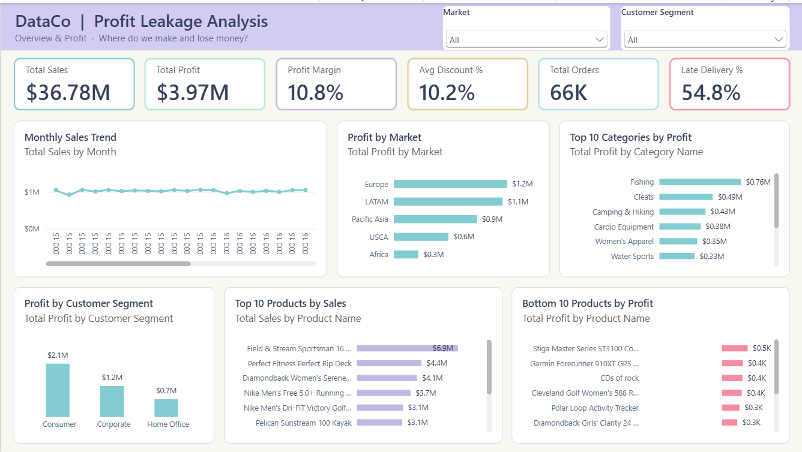
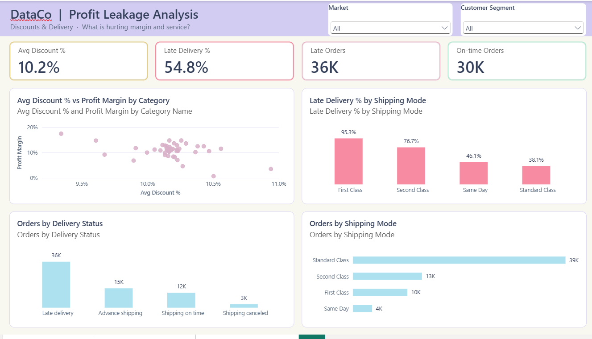
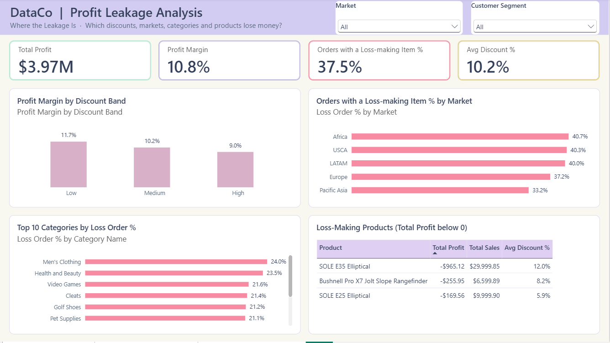

# DataCo Supply Chain: Profit Leakage Analysis

*An end-to-end analysis of sales, profit, discounting, and delivery performance using MySQL and Power BI.*

---

## Project Overview

This project evaluates revenue retention, margin erosion, and fulfillment performance across 180,519 transaction records from the DataCo Smart Supply Chain dataset covering January 2015 to January 2018.

By combining MySQL data validation, Power Query transformations, DAX modeling, and an interactive three-page Microsoft Power BI dashboard, this analysis identifies structural profit leakage across discounting tiers, geographic markets, product portfolios, and fulfillment operations.

### Tools and Methods
- **MySQL**: Relational data validation, cleaning, aggregations, and trend extraction.
- **Power Query**: Data type conversions, schema validation, and date standardization.
- **DAX**: Business measures, calculated columns, and KPI modeling.
- **Microsoft Power BI**: Interactive multi-page visual reporting and diagnostic drill-downs.
- **Excel**: Initial data inspection, pivot validation, and scenario testing.

---

## Business Problem

A business can report strong top-line sales while simultaneously experiencing profit erosion due to excessive discounting, loss-making product lines, and fulfillment inefficiencies. This project investigates the DataCo dataset to determine where profit is retained and where it leaks.

Key business questions addressed:
- How much gross revenue and net profit does the business generate, and what is the overall profit margin?
- How do discounting tiers correlate with order-level and product-level profitability?
- Which geographic markets, customer segments, and product categories drive the highest and lowest profit?
- Which specific products generate negative profit?
- How do sales and profit trajectories evolve across monthly intervals?
- How reliable is fulfillment across shipping modes, and where is late-delivery risk concentrated?

---

## Objectives

- Audit gross sales, net profit, and baseline margin performance across all recorded transactions.
- Analyze the statistical correlation between discount levels and profit margin degradation.
- Evaluate profit contribution across geographic markets, customer segments, and merchandise categories.
- Isolate products and order lines with negative profit to quantify total profit leakage.
- Track monthly revenue and profit trajectories between January 2015 and January 2018.
- Assess delivery reliability across shipping modes and identify logistical bottlenecks.
- Build a structured, three-page Power BI dashboard to communicate diagnostic findings to operational stakeholders.

---

## Tools and Technologies

| Tool | Purpose |
|---|---|
| MySQL | Relational data validation, cleaning, aggregation, and query analysis |
| Power Query | Date/time standardization, type correction, and ETL transformations |
| DAX | Calculated columns, dynamic aggregations, and business KPI measures |
| Microsoft Power BI | Interactive three-page analytical dashboard development |
| Microsoft Excel | Initial data profiling, pivot verification, and scenario analysis |

---

## Dataset

| Attribute | Value |
|---|---|
| Dataset | DataCo Smart Supply Chain |
| Database | `hidden_cost_growth` |
| Table | `dataco_orders` |
| Record grain | One row per order line item |
| Records | 180,519 |
| Distinct orders | 65,752 |
| Distinct products | 118 |
| Date range | 1 January 2015 – 31 January 2018 |

The source dataset was inspected, cleaned, and preprocessed. Due to GitHub file upload limits, a reduced dataset file is stored in this repository; the complete raw dataset is publicly accessible via the [Kaggle DataCo Smart Supply Chain Dataset](https://www.kaggle.com/datasets/shashwatwork/dataco-smart-supply-chain-for-big-data-analysis).

---

## Data Preparation

The data transformation and validation pipeline followed these sequential steps:

1. **Schema and Data Type Inspection**: Reviewed source column headers, string formats, numeric fields, and null distributions.
2. **Volume Validation**: Confirmed total records (180,519) and unique orders (65,752) across source files and database tables.
3. **Date Format Reconciliation**: Identified two distinct date format patterns in the order date field: `MM/DD/YYYY HH:MM` and `DD-MM-YYYY HH:MM`.
4. **Standardization**: Applied a unified date parsing expression in MySQL and synchronized date parsing in Power Query.
5. **Zero-Error Verification**: Confirmed zero unparsed or invalid date rows following the standardization routine.
6. **Feature Engineering**: Built Power BI calculated columns for time intelligence and segment grouping: `Month Start`, `Month_Year`, `Month_Sort`, and `Discount Band` (Low: below 10%; Medium: 10% to below 20%; High: 20% and above).

### Date Standardization SQL Expression

```sql
COALESCE(
    STR_TO_DATE(`order date (DateOrders)`, '%m/%d/%Y %H:%i'),
    STR_TO_DATE(`order date (DateOrders)`, '%d-%m-%Y %H:%i')
)
```

---

## SQL Analysis

The following core SQL queries were executed in MySQL to audit baseline metrics and prepare aggregated trend data:

```sql
-- 1. Total records
SELECT COUNT(*) AS total_records 
FROM dataco_orders;

-- 2. Distinct order count
SELECT COUNT(DISTINCT `Order Id`) AS total_orders 
FROM dataco_orders;

-- 3. Total sales volume
SELECT SUM(Sales) AS total_sales 
FROM dataco_orders;

-- 4. Total profit generated
SELECT SUM(`Order Profit Per Order`) AS total_profit 
FROM dataco_orders;

-- 5. Monthly sales and profit trajectory
SELECT
    DATE_FORMAT(
        COALESCE(
            STR_TO_DATE(`order date (DateOrders)`, '%m/%d/%Y %H:%i'),
            STR_TO_DATE(`order date (DateOrders)`, '%d-%m-%Y %H:%i')
        ), '%Y-%m') AS month,
    SUM(Sales) AS monthly_sales,
    SUM(`Order Profit Per Order`) AS monthly_profit
FROM dataco_orders
WHERE COALESCE(
        STR_TO_DATE(`order date (DateOrders)`, '%m/%d/%Y %H:%i'),
        STR_TO_DATE(`order date (DateOrders)`, '%d-%m-%Y %H:%i')
      ) IS NOT NULL
GROUP BY month
ORDER BY month;
```

---

## DAX Measures

The analytical data model uses the following measures for dashboard calculations:

| Measure | Definition |
|---|---|
| Total Sales | `SUM(DataCo_Orders[Sales])` |
| Total_Profit | `SUMX(DataCo_Orders, DataCo_Orders[Order Profit Per Order])` |
| Profit_Margin | `DIVIDE([Total_Profit], [Total Sales], 0)` |
| Total_Orders | `DISTINCTCOUNT(DataCo_Orders[Order Id])` |
| Avg_Discount_Percentage | `AVERAGE(DataCo_Orders[Order Item Discount Rate])` |
| Late_Orders | `CALCULATE(DISTINCTCOUNT(DataCo_Orders[Order Id]), DataCo_Orders[Late_delivery_risk] = 1)` |
| On_Time_Orders | `CALCULATE(DISTINCTCOUNT(DataCo_Orders[Order Id]), DataCo_Orders[Late_delivery_risk] = 0)` |
| Late_Delivery_Percentage | `DIVIDE([Late_Orders], [Total_Orders], 0)` |
| Loss Order % | Distinct orders with at least one line where `Order Profit Per Order < 0`, divided by `Total_Orders` |

---

## Verified Baseline Metrics

The following metrics were computed directly across the entire 180,519-row dataset with no slicer filters applied:

| Metric | Value |
|---|---:|
| Total Sales | 36,784,735.01 |
| Total Profit | 3,966,902.97 |
| Profit Margin | 10.78% |
| Average Discount Rate | 10.17% |
| Distinct Orders | 65,752 |
| Late Orders | 36,048 |
| Late Delivery Rate | 54.82% |
| On-time Orders | 29,704 |
| On-time Rate | 45.18% |

### Methodology Notes
- **Profit Margin Denominator**: The headline margin of 10.78% is computed using gross `Sales` (before discount). If evaluated against `Order Item Total` (net sales after discount, totaling 33,054,402.38), the identical profit yields a 12.00% net margin. The Power BI dashboard explicitly uses gross Sales as its denominator.
- **On-Time Order Categorization**: `On_Time_Orders` includes 2,855 orders with delivery status "Shipping canceled" because they carry `Late_delivery_risk = 0`.
- **Loss Order Definition**: 24,649 distinct orders (37.49%) contain at least one negative-profit line item. In contrast, 18.71% of all individual line items generate negative profit. The `Loss Order %` measure represents the order-level definition (37.49%).

---

## Detailed Analysis

### Profit by Market

| Market | Sales | Profit |
|---|---:|---:|
| Europe | 10,872,396.80 | 1,169,442.96 |
| LATAM | 10,277,612.84 | 1,123,321.61 |
| Pacific Asia | 8,273,743.74 | 857,753.44 |
| USCA | 5,066,528.71 | 564,313.78 |
| Africa | 2,294,452.93 | 252,071.18 |

### Profit by Customer Segment

| Segment | Sales | Profit |
|---|---:|---:|
| Consumer | 19,095,790.16 | 2,073,487.67 |
| Corporate | 11,168,406.84 | 1,202,574.96 |
| Home Office | 6,520,538.02 | 690,840.34 |

### Orders by Delivery Status

| Delivery Status | Distinct Orders |
|---|---:|
| Late delivery | 36,048 |
| Advance shipping | 15,127 |
| Shipping on time | 11,722 |
| Shipping canceled | 2,855 |

### Loss-Making Products

Across the entire product portfolio of 118 items, exactly three products generate negative total profit:

| Product | Total Profit | Total Sales | Orders |
|---|---:|---:|---:|
| SOLE E35 Elliptical | -965.12 | 29,999.85 | 15 |
| Bushnell Pro X7 Jolt Slope Rangefinder | -255.95 | 6,599.89 | 8 |
| SOLE E25 Elliptical | -169.56 | 9,999.90 | 10 |

Combined net loss across these three items is 1,390.63.

*Clarification on Visual Representation*: The dashboard visual titled "10 Lowest-Profit Products" ranks the ten lowest-performing products by total profit. It does not indicate that all ten products are unprofitable. Seven of the ten are profitable in absolute terms but generate lower total profit margins (e.g., GoPro HERO3+ Black Edition Camera at 245.63 and Diamondback Girls' Clarity 24 Hybrid Bike at 284.42).

---

## Power BI Dashboard

The Power BI report is organized into three analytical views designed for executive and operational evaluation.

### Page 1: Overview and Profit



Page 1 provides a consolidated operational overview of revenue, profit, discounting, and order volume:
- **KPI Summary Cards**: Total Sales (36.78M), Total Profit (3.97M), Profit Margin (10.78%), Average Discount Rate (10.17%), Total Orders (65.75K), and Late Delivery Rate (54.82%).
- **Trend Visual**: Monthly Sales Trend tracking revenue performance from January 2015 to January 2018.
- **Categorical Breakdowns**: Profit by Market, Profit by Category, and Profit by Customer Segment.
- **Product Rankings**: Top 10 Products by Sales alongside the 10 Lowest-Profit Products.
- **Interactive Controls**: Market and Customer Segment slicers to support filtered variance analysis.

### Page 2: Discounts and Delivery



Page 2 evaluates the interplay between commercial promotional discounting and physical logistics reliability:
- **Operational KPI Cards**: Average Discount %, Late Delivery %, Late Orders (36,048), On-time Orders (29,704), and Total Orders (65,752).
- **Discount vs. Profit Relationship**: Scatter plot analyzing individual transaction discount rates against order profit per order.
- **Shipping Mode Performance**: Late Delivery % by Shipping Mode, comparing fulfillment reliability across shipping tiers.
- **Fulfillment Status Breakdowns**: Orders by Delivery Status and total order distribution by Shipping Mode.

### Page 3: Where the Leakage Is



Page 3 isolates specific drivers of margin erosion across product lines, discount tiers, and regions:
- **Leakage KPI Cards**: Total Profit (3.97M), Loss Order % (37.49%), and Profit Margin (10.78%).
- **Negative-Profit Product Table**: Tabular breakdown isolating the three products generating negative cumulative profit.
- **Margin Degradation by Discount Band**: Bar chart showing profit margin contraction across Low (<10%), Medium (10% to <20%), and High (>=20%) discount tiers.
- **Segmented Profitability**: Regional and category-level profit contributions to highlight areas with low revenue-to-profit conversion.

---

## Key Insights

1. **Revenue and Net Margin**: Sales of 36.78 million generated 3.97 million in profit, yielding a 10.78% gross sales profit margin.
2. **Regional Concentration**: Europe and LATAM collectively account for approximately 58% of global profit, whereas Africa contributes the lowest share at approximately 6%.
3. **Segment Contribution**: The Consumer customer segment generates approximately 52% of total business profit.
4. **Fulfillment Bottlenecks**: More than half of all orders (54.82%) experience late delivery, representing the primary operational liability across the supply chain.
5. **Product Portfolio Health**: Only 3 of 118 products lose money overall, with cumulative losses limited to 1,390.63.
6. **Order-Level Profit Erosion**: While negative products are rare, 37.49% of all distinct orders contain at least one loss-making order line.
7. **Discount Band Margin Erosion**: Profit margin drops progressively as discount depth increases:
   - Low Discount (below 10%): **11.7%** profit margin
   - Medium Discount (10% to below 20%): **10.2%** profit margin
   - High Discount (20% and above): **9.0%** profit margin
8. **Shipping Mode Fulfillment Risk**: Expedited shipping modes demonstrate severely elevated late delivery rates:
   - First Class: **95.3%** late delivery rate
   - Second Class: **76.7%** late delivery rate
   - Same Day: **46.1%** late delivery rate
   - Standard Class: **38.1%** late delivery rate

---

## Business Recommendations

1. **Enforce Dynamic Discount Guardrails**: Re-evaluate discount authorization policies in high-discount tiers (>=20%) where profit margin drops to 9.0%. Set maximum discount thresholds for low-margin product categories.
2. **Targeted Pricing and Cost Review for Loss-Making Items**: Review unit economics, freight costs, and pricing structures for the three negative-margin products (`SOLE E35 Elliptical`, `Bushnell Pro X7 Jolt Slope Rangefinder`, and `SOLE E25 Elliptical`).
3. **Overhaul Expedited Shipping Operations**: Investigate logistical bottlenecks in First Class (95.3% late) and Second Class (76.7% late) fulfillment. Carrier contracts and transit time promises must be renegotiated or realigned with realistic delivery capabilities.
4. **Audit Multi-Item Order Profitability**: Investigate why 37.49% of distinct orders contain a loss-making line item. Analyze whether customers bundle loss-leader promotional products with standard orders and adjust minimum cart requirements.

---

## Limitations

- **Margin Denominator**: Profit margin is reported on gross sales (10.78%). Evaluated on net sales after discounts (33,054,402.38), the net margin is 12.00%.
- **Cancelled Order Classification**: `On_Time_Orders` includes 2,855 cancelled shipments due to the dataset rule `Late_delivery_risk = 0`.
- **Order-Level Loss Definition**: `Loss Order %` flags any order containing at least one negative-margin line item; this does not mean the entire net order was unprofitable.
- **Sample Representation**: Findings reflect the specific transaction scope of the public DataCo Smart Supply Chain dataset.

---

## How to Open the Dashboard

1. Install and open the latest version of **Microsoft Power BI Desktop**.
2. Open the project file: [`powerbi/DataCo_Supply_Chain_Analysis.pbix`](powerbi/DataCo_Supply_Chain_Analysis.pbix).
3. To view company-wide baseline metrics, ensure all slicers on each page are cleared.

*Deployment Note*: The report has been deployed to the author's Power BI Service workspace for internal review. Public web embedding is currently restricted by organization tenant security policies.

---

## Repository Structure

```text
DataCo-Supply-Chain-Analytics/
├── README.md
├── datasets/
│   └── raw/
│       ├── DataCoSupplyChainDataset.csv
│       └── DescriptionDataCoSupplyChain.csv
├── excel/
│   ├── DataCo_Scenario_Analysis.xlsx
│   ├── DataCo_cleaned.xlsx
│   └── Pivot_Analysis.xlsx
├── powerbi/
│   ├── 01_overview_profit.png
│   ├── 02_discounts_delivery.png
│   ├── 03_leakage.png
│   └── DataCo_Supply_Chain_Analysis.pbix
└── sql/
    └── DataCo_Profit_Leakage_Analysis.sql
```

---

## Skills Demonstrated

- **SQL Data Validation**: Multi-table aggregation, date-time parsing, and data integrity verification.
- **Relational Schema Auditing**: Transaction grain validation and metric reconciliation.
- **Power Query ETL**: Inconsistent date resolution, type casting, and calculated data transformations.
- **DAX Modeling**: Measure development, dynamic ratios, filter manipulation, and KPI logic.
- **Microsoft Power BI Development**: Interactive three-page reporting, visual hierarchy, and cross-filtering design.
- **Commercial Margin Diagnostics**: Profit leakage isolation, discount band erosion, and loss-leader detection.
- **Supply Chain Fulfillment Analytics**: Carrier reliability assessment and shipping risk modeling.

---

## Author and Contact

- **Author**: Spoorti
- **GitHub**: [github.com/spoortibiradar8](https://github.com/spoortibiradar8)
- **Repository**: [DataCo-Supply-Chain-Analytics](https://github.com/spoortibiradar8/DataCo-Supply-Chain-Analytics)
- **Category**: Data Analytics, Business Intelligence, Supply Chain Analytics
